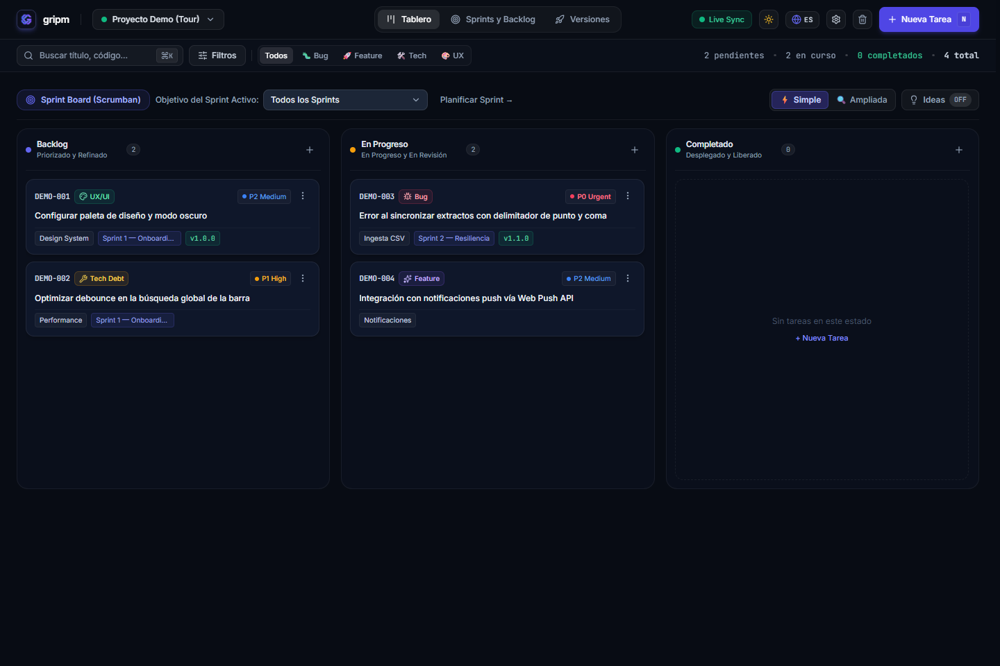
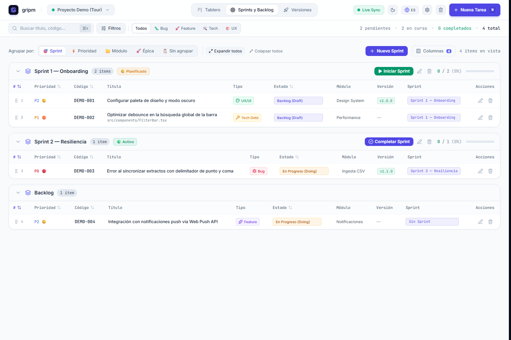
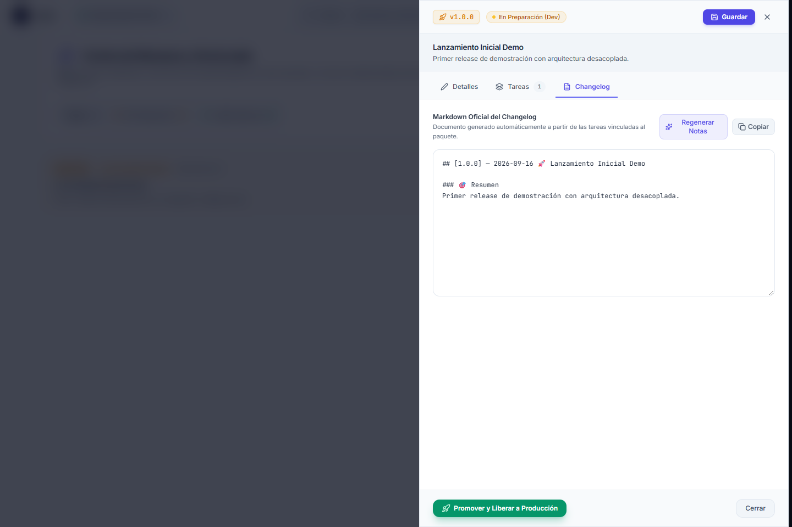
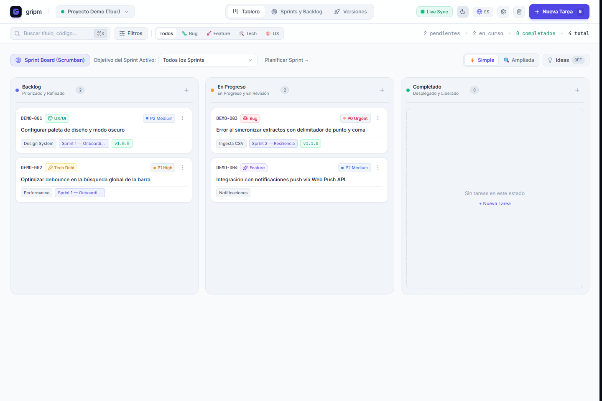

<p align="center">
  
</p>

<h1 align="center">gripm</h1>

<p align="center">
  <strong>A sovereign, local-first Agile & Product Management Cockpit for developers and AI pair programmers.</strong>
</p>

<p align="center">
  🌐 <strong><a href="README.md">English</a></strong> | <strong><a href="README.es.md">Español</a></strong>
</p>

<p align="center">
  <a href="https://www.npmjs.com/package/@gripm/board"></a>
  <a href="https://nodejs.org">=20.0.0 (LTS)" /></a>
  <a href="https://modelcontextprotocol.io/"></a>
  <a href="https://github.com/pablojavierrodriguez/gripm-playbook"></a>
  <a href="LICENSE"></a>
  <a href="https://gripm.vercel.app"></a>
</p>

<p align="center">
  <a href="https://gripm.vercel.app">Try it live at <strong>gripm.vercel.app</strong></a> - a zero-install sandbox running on sample data. Changes stay in your browser and never touch the cloud.
</p>

<p align="center">
  
</p>

> **Your roadmap should live alongside your code, not on third-party servers.** Gripm is a local workspace for tracking backlog items, iterative planning, and software releases. It provides developers and autonomous AI agents (Cursor, Claude Code, Antigravity) with structured specifications, acceptance criteria gates, and offline speed.

---

## Why gripm

Static `TODO.md` files fail as projects expand, while cloud issue trackers lock your roadmap behind proprietary APIs, network latency, and third-party databases. Gripm pairs the ergonomics of a modern web board with the sovereignty of Git and native AI agent tooling:

| Factor | Cloud Issue Trackers | Static Markdown Files | gripm |
| :--- | :--- | :--- | :--- |
| **Storage & Privacy** | Stored on third-party cloud infrastructure | Flat local text files | **Local-first**. Distributed Markdown (`backlog/tasks/*.md`) or single JSON. |
| **Git Integration** | External webhooks and sync scripts | Raw edits without structure | Version tasks in the same commits and Pull Requests as the code. |
| **Human Interface** | Web apps requiring logins and accounts | Plain text editor | **Local web cockpit** (`localhost:4100`) with Kanban, Sprints, and Releases. |
| **AI Agent Access** | Rate-limited web plugins and scrapers | High token consumption | **Native stdio MCP server** (`gripm-mcp`) with mechanical quality gates. |
| **Offline Operation** | Requires active internet connection | 100% offline | **100% offline execution** with zero telemetry or cloud dependencies. |

---

## Quickstart

Requires Node.js 20.0.0 (LTS) or later.

### 1. Initialize your project

Run inside your repository:

```bash
npx @gripm/board --init
```

The onboarding wizard prompts for your preferred language (`en` or `es`), adoption profile (`Minimalist AI-First`, `Batteries-Included`, or `Custom`), and optionally links [Gripm Playbook](https://github.com/pablojavierrodriguez/gripm-playbook) team roles. It configures `.gripm/config.json`, bootstraps `backlog/tasks/`, installs the agent skill (`.agents/skills/gripm/`), and adds `"board"` and `"mcp"` scripts to your `package.json`.

*Non-interactive initialization for CI or scripts:*
```bash
npx @gripm/board --init -y
```

### 2. Launch the visual board

```bash
npx @gripm/board
```
*Or via package script:*
```bash
npm run board
```

The cockpit starts on `http://localhost:4100` and opens automatically in your browser.

> [!TIP]
> Install globally with `npm install -g @gripm/board` to use the direct commands `gripm`, `gripm add`, and `gripm-mcp`.

---

## AI Agent Integration (MCP)

Gripm provides a built-in **Model Context Protocol (MCP)** server over `stdio` (`gripm-mcp`), allowing AI coding assistants to query, create, and update tasks in real time.

### Configuration

Add Gripm to your AI client's configuration (e.g. `claude_desktop_config.json` or Cursor's MCP settings):

```json
{
  "mcpServers": {
    "gripm": {
      "command": "npx",
      "args": ["-y", "-p", "@gripm/board", "gripm-mcp", "--repo", "/absolute/path/to/my-project"]
    }
  }
}
```
*(If `--repo` is omitted, the server defaults to the current working directory provided by the AI client).*

### Mechanical Quality Gatekeeper (Zero-Hallucination Delivery)

The MCP server enforces delivery integrity before allowing transitions to `ready` or `done`:
- **Unchecked Acceptance Criteria Protection:** Rejects task promotion if any criteria remain uncompleted (`- [ ]`), reporting the exact pending items to the agent.
- **Verification Command Gate (`verifyCommand`):** Can execute automated checks (e.g. `npm test`, `npx tsc --noEmit`) before certifying a state change.
- **Deterministic Status Vocabulary:** Restricts task progression to valid delivery states (`draft`, `doing`, `review`, `ready`, `done`).

<details>
<summary><strong>View all 12 MCP Tools</strong></summary>

| Tool | Description | Key Arguments |
| :--- | :--- | :--- |
| `gripm_list_projects` | Lists registered projects and their storage format. | None |
| `gripm_get_stats` | Consolidated metrics (% completion, open/closed, prefix distribution). | `projectId` |
| `gripm_list_tasks` | Token-efficient query with 1-line `compact` format, `openOnly`, and prefix filters. | `projectId`, `status`, `openOnly`, `prefix`, `taskIds`, `format`, `limit` |
| `gripm_get_task` | Full task details, acceptance criteria, and technical plan. | `taskId` (e.g. `"DEV-001"`) |
| `gripm_create_task` | Creates a new task in native Markdown or JSON format. | `title`, `description`, `type`, `priority`, `acceptanceCriteria` |
| `gripm_update_task` | Updates status, toggles acceptance criteria, or updates plans. | `taskId`, `status`, `toggleAcIndex`, `implementationPlan`, `verifyCommand` |
| `gripm_bulk_update_tasks` | Atomic batch update across multiple tasks (by prefix or ID list). | `projectId`, `taskIds`, `filterPrefix`, `updates` |
| `gripm_list_releases` | Queries published releases, changelog notes, and linked items. | `projectId`, `version` |
| `gripm_export_backlog` | Generates or refreshes the consolidated `BACKLOG.md` report. | `projectId` |
| `gripm_sync_backlog` | Audits and reconciles completed tasks with acceptance criteria. | `projectId`, `autoFix` |
| `gripm_create_retro` | Saves a structured sprint retrospective in `backlog/retros/`. | `projectId`, `sprintId`, `sprintName`, `whatWentWell`, `whatWentWrong` |
| `gripm_list_retros` | Lists historical sprint retrospectives. | `projectId` |

</details>

---

## Product Views

| Iterations & Backlog Planning | Release Notes & Changelog |
| :---: | :---: |
|  |  |
| **Kanban - Light Mode** | **Kanban - Dark Mode** |
|  |  |

---

## Core Capabilities

### Dual Storage Engine (Markdown or JSON)
Choose how to persist your project without external databases:
- **Distributed Markdown (`backlog-md`):** Individual files at `backlog/tasks/<CODE> - <Title>.md` with YAML frontmatter. Designed for version control with near-zero merge conflicts.
- **Single JSON File (`json`):** Compact storage at `.gripm/backlog.json`.
- **Bidirectional Conversion:** Switch formats at any time from project settings with a single click.

### Modular Agile Workflow
Enable or disable tabs according to your team's cadence under **Settings > Modules & Add-ons** or in `.gripm/config.json`:
- **Kanban Core:** Continuous flow, custom columns, WIP limits, and instant filtering.
- **Sprints:** Optional timeboxed planning for iterative Scrum teams.
- **Releases:** Package delivered value (`ready`) into semantic versions and generate `CHANGELOG.md` independently of sprints.

### Concurrent Multi-Agent Isolation with Git Worktrees
When running parallel autonomous agents or human developers, prevent dirty working tree collisions by checking out tasks in isolated worktrees:
```bash
git worktree add ../my-app-DEV-221 -b feature/DEV-221
cd ../my-app-DEV-221
gripm-mcp --repo .
```
Because Gripm stores items as independent Markdown files, merging branches back into the main tree produces clean, conflict-free merges.

---

## CLI Reference

| Command / Flag | Purpose |
| :--- | :--- |
| `gripm` | Starts the web cockpit on `http://localhost:4100` and launches the browser. |
| `gripm --init` | Interactive onboarding wizard (creates `.gripm/`, `backlog/tasks/`, skill, and scripts). |
| `gripm add "<title>" [options]` | Quick task capture from the terminal (`--priority`, `--type`, `--due`, `--labels`). |
| `gripm import --file <path>` | Universal offline importer for Jira (JSON/CSV), Linear (CSV), or generic CSV files. |
| `gripm mcp` | Starts the `stdio` MCP server (identical to `gripm-mcp`). |
| `gripm playbook sync` | Synchronizes role skills and agile methodology guides from Gripm Playbook into `.agents/`. |
| `gripm --uninstall` | Cleanly detaches Gripm from the repository (preserves `backlog/` and `BACKLOG.md`). |
| `--port <num>` | Custom port for the web server (default: `4100`). |
| `--host <address>` | Bind address (e.g. `--host 0.0.0.0` for LAN access with an ephemeral security token). |
| `--repo <path>` | Targets an explicit repository directory instead of the current folder. |
| `--hub` / `--single` | Forces Multi-Project Hub mode or isolated Single-Project mode. |
| `--no-open` | Starts the server without automatically opening the browser. |

<details>
<summary><strong>Universal Importer Details (Jira, Linear, CSV)</strong></summary>

Import existing backlogs directly into individual Markdown task files with zero cloud calls:

```bash
# Preview detected tasks without writing to disk
gripm import --file ./jira-export.json --dry-run

# Import and set custom task code prefix
gripm import --file ./linear-export.csv --prefix FEAT
```
Supported formats: Jira JSON/CSV, Linear CSV, and generic tabular CSV exports.
</details>

<details>
<summary><strong>Repository Privacy & Git Strategies</strong></summary>

Gripm is local-first: tasks live on your filesystem.
- **Public Backlog as Code:** For internal or open-source projects with public roadmaps, commit `backlog/tasks/` to Git for full PR traceability.
- **Private Backlog in Public Repos:** Add `.gripm/` and `backlog/` to `.gitignore` to use the board and MCP locally without pushing task contents to GitHub.
- **Dedicated Backlog Repository:** Maintain tasks in a private sibling repository and point Gripm or MCP via `--repo ../my-project-backlog`.
</details>

<details>
<summary><strong>Keyboard Shortcuts</strong></summary>

- `?`: Open keyboard shortcuts cheat sheet
- `N`: Create new backlog task
- `⌘K` / `Ctrl+K` or `/`: Focus instant search bar
- `1` - `4`: Switch tabs (`1`: Board, `2`: Sprints & Backlog, `3`: Releases, `4`: Trash)
- `⌘,` / `Ctrl+,`: Toggle Settings view
- `Esc`: Close open modal / drawer
- `⌘+Enter` / `Ctrl+Enter`: Save task / form
- `⌘S` / `Ctrl+S`: Save configuration (in Settings)
</details>

---

## Gripm Tools Ecosystem

The Gripm ecosystem consists of two decoupled, standalone tools designed to complement each other:

- **Gripm Board (`@gripm/board`, this package):** The local web cockpit, CLI, Markdown/JSON storage engine, and native MCP server. Fully autonomous; does not require Gripm Playbook.
- **[Gripm Playbook](https://github.com/pablojavierrodriguez/gripm-playbook) (`@gripm/playbook`):** Deterministic agile delivery governance for AI agents (role skills: `pm-orchestrator`, `principal-engineer`, `qa-auditor`, `product-designer`, and executable static UX auditing). Can be used with Jira, Linear, Gripm Board, or no visual board at all.

To equip your repository with Playbook roles using Gripm Board, run `gripm playbook sync`.

---

<details>
<summary><strong>Contributing & Core Development</strong></summary>

Gripm manages its own development with Gripm Board; every code modification is tracked in `backlog/tasks/`.

```bash
git clone https://github.com/pablojavierrodriguez/gripm.git
cd gripm
npm install
npm run dev
```

Verification suite:
```bash
npm run lint          # TypeScript strict typechecking (tsc --noEmit)
npm test              # Unified headless test suite (18 sequential steps)
npm run backlog:check # Backlog and task integrity verification
npm run build         # Bundle Vite assets and package binaries
```

Guides:
- **[CONTRIBUTING.md](CONTRIBUTING.md)** - Verification pyramid, coding standards, and branch conventions.
- **[CODE_OF_CONDUCT.md](CODE_OF_CONDUCT.md)** - Contributor Covenant v2.1.
- **[SECURITY.md](SECURITY.md)** - Vulnerability reporting policy.
- **[CHANGELOG.md](CHANGELOG.md)** - Version history generated from releases.
- **[AGENTS.md](AGENTS.md)** - Operational guidelines for developers and autonomous agents.
</details>

---

## License

MIT © 2026 gripm Contributors
