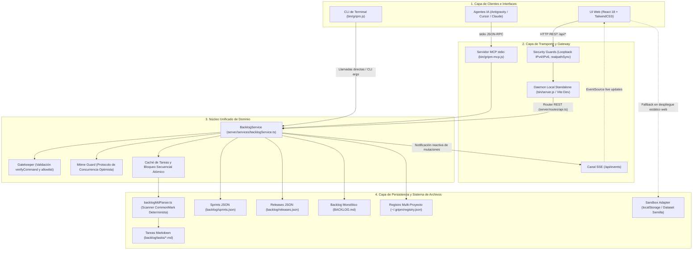
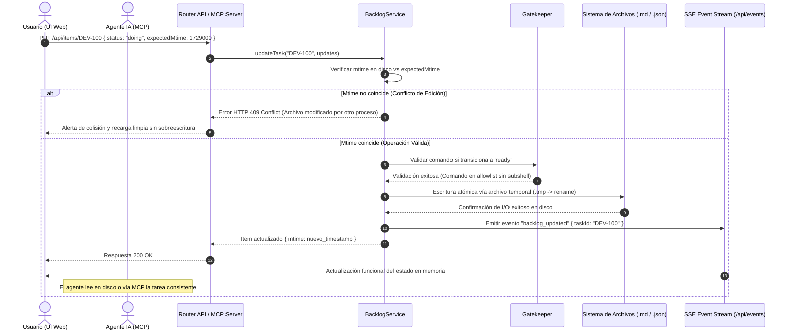
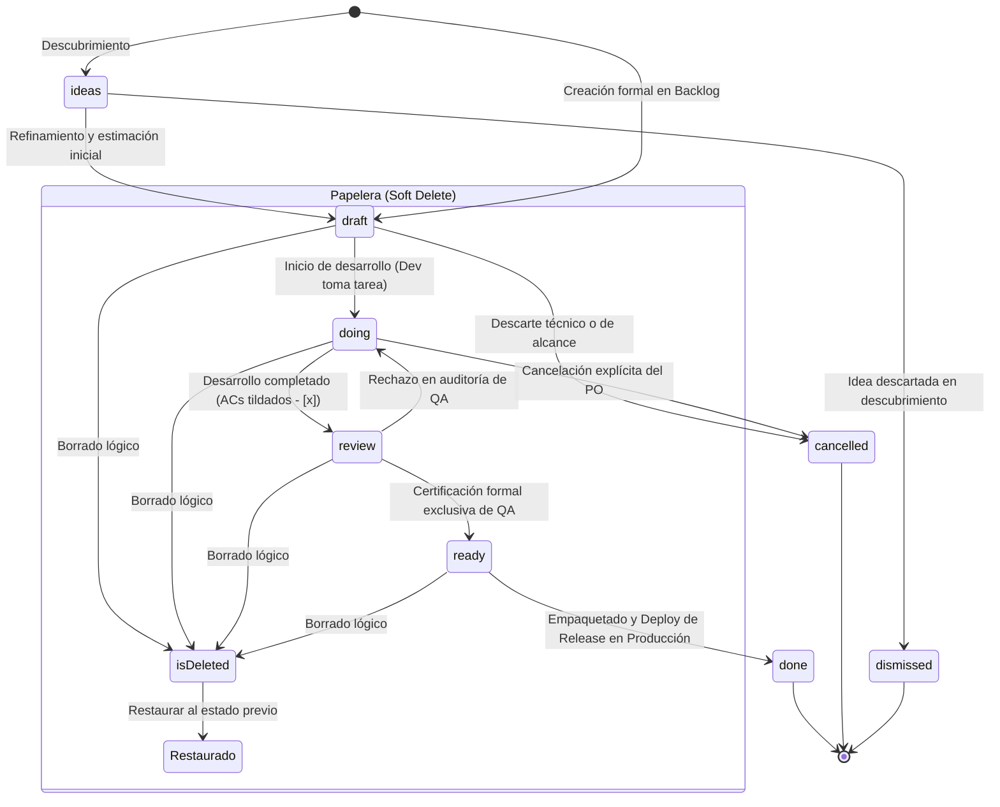

# Arquitectura del Sistema gripm

Este documento describe la topología, capas, flujo de datos, concurrencia y mapa de componentes de **gripm**. Constituye la referencia técnica canónica tanto para desarrolladores humanos como para agentes autónomos de IA (Antigravity, Cursor, Claude Code) con el fin de agilizar la navegación del código, el entendimiento del flujo de estados y el análisis de impacto.

---

## 1. Visión General del Sistema

gripm es un tablero ágil de gestión de producto e ingeniería *embedded-first* diseñado para la colaboración fluida entre desarrolladores humanos y agentes de IA:

- **Local-first & Zero-cloud**: Todos los datos residen en el repositorio local en formato Markdown nativo (`backlog/tasks/*.md`) con frontmatter YAML o en base JSON local.
- **Dogfooding estricto**: Cada cambio de código se asocia y sincroniza con tareas vivas del backlog bajo la metodología de Gripm Playbook.
- **Triple Interfaz Unificada**:
  1. **UI Web Visual**: Aplicación web desarrollada en React 18 + Vite + TailwindCSS.
  2. **Agente / Protocolo MCP**: Servidor stdio (`gripm-mcp`) que expone herramientas semánticas (`gripm_list_tasks`, `gripm_update_task`, etc.) para agentes autónomos.
  3. **CLI de Terminal**: Binario ejecutable local y global (`gripm`) para gestión rápida y headless.
- **Dual Runtime**:
  - **Modo Daemon Local**: Backend Node.js embebido con persistencia real en disco.
  - **Modo Sandbox Web (Vercel)**: Adaptador en memoria y `localStorage` con paridad 100% de contrato de API (`src/data/sandbox.ts`).

---

## 2. Topología General y Flujo de Datos

---

## 3. Flujo de Mutación Atómica y Concurrencia Optimista

Para evitar colisiones cuando un agente de IA y un usuario interactúan simultáneamente en la interfaz web, el sistema implementa un protocolo de concurrencia optimista basado en `expectedMtime` con persistencia atómica en disco y difusión en tiempo real vía SSE.

---

## 4. Máquina de Estados del Flujo Ágil

El ciclo de vida de los ítems en gripm sigue la máquina de estados formal normada en el framework Playbook, con estricta separación entre desarrollo, certificación y despliegue:

> [!IMPORTANT]
> **Invariantes del Flujo de Estados:**
> 1. **La línea de llegada del agente/desarrollador es `ready`**. Un desarrollador o agente jamás marca `done`.
> 2. **El paso a `done` es exclusivo de Release Management**: Ninguna tarea pasa a `done` sin estar empaquetada y desplegada formalmente en una versión.
> 3. **Soft-delete reversible**: Cualquier ítem enviado a la Papelera conserva su `previousStatus` para garantizar una restauración 100% limpia.

---

## 5. Catálogo de Archivos Clave y Descomposición Modular

### Frontend Modular (`src/`)

Para garantizar modularidad y mantenibilidad, los componentes monolíticos históricos fueron descompuestos en submódulos especializados (< 500 líneas):

| Archivo / Directorio | Responsabilidad Principal |
| :--- | :--- |
| [src/App.tsx](src/App.tsx) | Orquestador principal de la UI. Mantiene estado de proyecto, vistas activas, routing, atajos de teclado y suscripción a eventos SSE. |
| [src/components/Header.tsx](src/components/Header.tsx) | Barra superior con selector de proyecto multi-repo, switcher de vistas, búsqueda global y notificaciones de versión. |
| [src/components/KanbanBoard.tsx](src/components/KanbanBoard.tsx) | Tablero visual Kanban con columnas por estado, drag & drop, agrupación y renderizado optimizado a 60 FPS. |
| [src/components/SprintView.tsx](src/components/SprintView.tsx) | Vista de planificación de sprints, velocidad, burndown y balance de carga. |
| [src/components/ReleaseAssembler.tsx](src/components/ReleaseAssembler.tsx) | Ensamblador de versiones (`unreleased` / `released`), generador de changelogs y vinculación de tags Git. |
| [src/components/TrashView.tsx](src/components/TrashView.tsx) | Panel de Papelera con soporte para soft-delete, restauración segura al estado previo y purga definitiva. |
| [src/components/FilterBar.tsx](src/components/FilterBar.tsx) | Barra de filtrado rápido con chips interactivos para búsqueda, tipos, prioridades y asignados. |
| [src/components/AdvancedFiltersPopover.tsx](src/components/AdvancedFiltersPopover.tsx) | Popover con filtros avanzados combinados y multi-selección de sprints, releases y módulos. |
| [src/utils/filterItems.ts](src/utils/filterItems.ts) | Motor de filtrado unificado y tipado para Kanban, Sprint y Backlog con soporte para campos multi-valor. |
| [src/components/ItemModal.tsx](src/components/ItemModal.tsx) | Orquestador de detalle de tarea. Delega su renderizado en submódulos de `src/components/item-modal/`. |
| [src/components/item-modal/](src/components/item-modal/) | Submódulos del modal de tareas: `AcceptanceCriteriaPanel`, `ItemRelationsPanel`, `ItemDescriptionPanel`, `ItemSidebarAttributes`, `ItemSidebarSchedule`, `ItemSidebarStatusType`, etc. |
| [src/components/SettingsView.tsx](src/components/SettingsView.tsx) | Orquestador de configuración general. Delega su renderizado en las pestañas de `src/components/settings/`. |
| [src/components/settings/](src/components/settings/) | Pestañas modulares: `KanbanTab`, `TaxonomyTab`, `ViewsTab`, `ModulesTab`, `ComponentsTab`, `ToolsTab`, `AdvancedTab`, `VisualTab`. |
| [src/data/sandbox.ts](src/data/sandbox.ts) | Adaptador interactivo de demostración para despliegues estáticos web (Vercel) con paridad total del contrato `GripmApi`. |

### Backend Embebido, Servicios & Herramientas (`server/`, `scripts/`, `bin/`)

| Archivo / Directorio | Responsabilidad Principal |
| :--- | :--- |
| [server/services/backlogService.ts](server/services/backlogService.ts) | **Motor canónico y único de persistencia y dominio.** Centraliza la lectura, mutación, cálculo de métricas, validaciones de Gatekeeper y bloqueo atómico. |
| [server/routes/api.ts](server/routes/api.ts) | Router REST de endpoints locales (`/api/data`, `/api/items`, `/api/projects`, `/api/events`, etc.). |
| [server/services/security.ts](server/services/security.ts) | Guardrails de aislamiento local: validación de loopback estricto (`127.0.0.1` y `[::1]`) y sanitización de encabezados. |
| [server/services/fsExplorer.ts](server/services/fsExplorer.ts) | Explorador de carpetas seguro con contención estricta mediante `realpathSync` contra ataques de symlink traversal. |
| [bin/server.js](bin/server.js) | Servidor standalone empaquetado para producción (Node.js nativo sin dependencias de Vite en runtime). |
| [bin/gripm.js](bin/gripm.js) | CLI binario unificado (`gripm`). Inicializa daemon o ejecuta comandos headless con flags `--single`, `--hub`, `--port`, etc. |
| [bin/gripm-mcp.js](bin/gripm-mcp.js) | Servidor MCP ejecutable que expone el catálogo `gripm_*` a agentes de IA mediante `stdio` JSON-RPC. |
| [scripts/backlogMdParser.ts](scripts/backlogMdParser.ts) | Tokenizador determinista CommonMark bidireccional entre archivos Markdown (`backlog/tasks/*.md`), `BACKLOG.md` y memoria. |
| [scripts/build-binaries.js](scripts/build-binaries.js) | Script de empaquetado con `esbuild` que compila los ejecutables standalone en `bin/`. |
| [scripts/verify-backlog-sync.js](scripts/verify-backlog-sync.js) | Guard de verificación viva pre-commit que audita coherencia de tareas, ACs y regenera `BACKLOG.md`. |

---

## 6. Seguridad y Superficie de Riesgo

El sistema implementa defensas en profundidad auditadas bajo los lineamientos `SEC-01` a `SEC-10`:

1. **Aislamiento en Loopback:** El daemon local se vincula por defecto exclusivamente a `127.0.0.1` y `::1`. Las peticiones externas o con host headers no autorizados son rechazadas.
2. **Gatekeeper Seguro (SEC-01):** La ejecución de comandos en el paso a `ready` solo se permite si el comando fue provisto explícitamente como argumento del MCP, rechazando subshells (`$()`), pipes (`|`), redirecciones (`>`) o cadenas de ejecución (`&&`, `;`). Queda terminantemente prohibido ejecutar comandos desde el frontmatter Markdown.
3. **Contención de Rutas de Filesystem (SEC-07):** Toda resolución de directorios en el navegador de proyectos valida la ruta física real (`realpathSync`) contra la raíz permitida para neutralizar enlaces simbólicos maliciosos.
4. **Cero Fabricación de ACs (SEC-02):** La sincronización automática opera con `autoFix: false` por defecto para impedir que herramientas alteren checkboxes `- [ ]` a `- [x]` sin verificación real.

---

## 7. Tabla de Impacto Rápido

| Si necesitas modificar... | Archivos principales a intervenir | Efecto colateral a vigilar |
| :--- | :--- | :--- |
| **Persistencia, mutaciones o reglas de negocio** | [server/services/backlogService.ts](server/services/backlogService.ts) | Paridad con MCP (`bin/gripm-mcp.js`), API REST y sandbox. |
| **Formato Markdown, YAML o secciones de tarea** | [scripts/backlogMdParser.ts](scripts/backlogMdParser.ts) | Correr `scripts/test-parser-roundtrip.js` (cero pérdida de datos). |
| **Formulario o paneles de edición de tareas** | [src/components/item-modal/](src/components/item-modal/), [src/components/ItemModal.tsx](src/components/ItemModal.tsx) | Preservar trampa de foco y contratos ARIA accesibles. |
| **Pestañas o paneles de configuración** | [src/components/settings/](src/components/settings/), [src/components/SettingsView.tsx](src/components/SettingsView.tsx) | Sincronización con `.gripm/config.json` y localStorage. |
| **Filtrado, búsqueda o multi-selección** | [src/utils/filterItems.ts](src/utils/filterItems.ts), [src/components/FilterBar.tsx](src/components/FilterBar.tsx) | Consistencia en Kanban, Backlog y vistas de Sprint. |
| **Herramientas para agentes IA (MCP)** | [scripts/mcp-server.ts](scripts/mcp-server.ts), [server/services/backlogService.ts](server/services/backlogService.ts) | Validar schemas de entrada y compatibilidad con `AGENTS.md`. |
| **Endpoints locales o transporte SSE** | [server/routes/api.ts](server/routes/api.ts), [src/api.ts](src/api.ts) | Manejo de CORS local y reconexión resiliente de eventos. |

---

## 8. Modelo Canónico de Datos de Tareas (Task Data Specification)

Cada tarea en gripm reside en `backlog/tasks/<ID> - <slug>.md`. Se compone de metadatos estructurados en YAML frontmatter y secciones de contenido delimitadas por comentarios HTML canónicos:

### A. Metadatos de YAML Frontmatter

| Campo Frontmatter | Tipo TypeScript / Valores | Semántica y Propósito |
| :--- | :--- | :--- |
| `id` | `string` (ej. `DEV-110`) | Identificador unívoco e inmutable. |
| `title` | `string` | Título del requerimiento o corrección. |
| `status` | `CanonicalStatus` (`ideas`, `draft`, `doing`, `review`, `ready`, `done`, `dismissed`, `cancelled`) | Estado formal en el flujo de valor. |
| `type` | `ItemType` (`feature`, `bug`, `tech_debt`, `ux`, `epic`, `initiative` + personalizados) | Taxonomía funcional. Admite tipos dinámicos. |
| `priority` | `Priority` (`p0`/`urgent`, `p1`/`high`, `p2`/`medium`, `p3`/`low`) | Nivel de urgencia o severidad. |
| `estimate` | `number` o `string` (ej. `5` o `"XL"`) | Estimación de esfuerzo. |
| `assignee` / `assignees` | `string[]` o `string` | Responsables asignados. |
| `labels` | `string[]` | Etiquetas transversales de búsqueda. |
| `sprint` / `targetSprint` | `string` (ej. `"Sprint 6"`) | Sprint de ejecución actual. |
| `sprints` | `string[]` | Historial de sprints asociados. |
| `release` / `targetRelease` | `string` (ej. `"1.5.0"`) | Versión de entrega planificada o entregada. |
| `releases` | `string[]` | Array multi-versión asignado. |
| `modules` | `string[]` | Módulos funcionales asociados a la tarea. |
| `parent` / `parentId` | `string` (ej. `"DEV-040"`) | Padre jerárquico 1-a-N (Épica o iniciativa). |
| `blocks` | `string[]` | Tareas que dependen de la entrega de este ítem. |
| `blocked_by` / `blockedBy` | `string[]` | Tareas que bloquean el inicio de este ítem. |
| `related_to` / `relatedTo` | `string[]` | Enlaces conceptuales no bloqueantes. |
| `dependencies` | `string[]` | Lista de dependencias funcionales del ítem. |
| `created_date` | `string` (datetime/ISO) | Fecha original de creación. |
| `updated_date` | `string` (datetime/ISO) | Timestamp de última modificación en disco. |
| `order` | `number` | Posición relativa en columnas de visualización. |
| `isDeleted` | `boolean` | Flag de borrado lógico (Papelera). |
| `deletedAt` | `string` (ISO) | Fecha y hora de envío a la papelera. |
| `previousStatus` | `string` | Estado previo para restauración limpia. |
| *Arbitrarios* (`rawExtraFrontmatter`) | `Record<string, string>` | Claves YAML adicionales preservadas en round-trip. |

### B. Secciones Delimitadas en el Cuerpo Markdown

| Sección | Delimitador Canónico | Propósito |
| :--- | :--- | :--- |
| `## Description` | `<!-- SECTION:DESCRIPTION:BEGIN -->` ... `<!-- SECTION:DESCRIPTION:END -->` | Contexto, especificación y User Stories. |
| `## Acceptance Criteria` | `<!-- AC:BEGIN -->` ... `<!-- AC:END -->` | Criterios de aceptación (`- [x] #1`, `- [ ] #1`) y escenarios BDD. |
| `## Implementation Plan` | `<!-- SECTION:PLAN:BEGIN -->` ... `<!-- SECTION:PLAN:END -->` | Plan de desarrollo paso a paso (Plan Guard). |
| `## Implementation Notes` | `<!-- SECTION:NOTES:BEGIN -->` ... `<!-- SECTION:NOTES:END -->` | Notas técnicas de desarrollo, cambios aplicados y riesgos. |
| `## Final Summary` | `<!-- SECTION:FINAL_SUMMARY:BEGIN -->` ... `<!-- SECTION:FINAL_SUMMARY:END -->` | Resumen de cierre o entrega de la tarea. |

---

## 9. Registro de Decisiones de Arquitectura (ADR)

Este documento describe **cómo está construido el sistema actualmente**. Los fundamentos de las decisiones y las alternativas evaluadas se documentan en [`docs/adr/`](adr/README.md).

| # | Decisión |
| :--- | :--- |
| [0001](adr/0001-markdown-como-fuente-de-verdad.md) | Markdown como fuente de verdad del backlog |
| [0002](adr/0002-backend-embebido-como-plugin-de-vite.md) | Backend embebido como plugin de middleware de Vite (Reemplazado) |
| [0003](adr/0003-servidor-mcp-por-stdio.md) | Servidor MCP sobre stdio con núcleo de persistencia compartido |
| [0004](adr/0004-daemon-local-sin-autenticacion-http.md) | Daemon local monousuario sin autenticación HTTP |
| [0005](adr/0005-overlays-via-portales-y-layout-estable.md) | Overlays montados vía portales y layout raíz estable (cero CLS) |
| [0006](adr/0006-servidor-estatico-produccion-desacoplado-de-vite.md) | Servidor estático HTTP desacoplado de Vite para producción |

Toda decisión con impacto estructural se documenta como un ADR numerado secuencial e inmutable en [`docs/adr/`](adr/).
