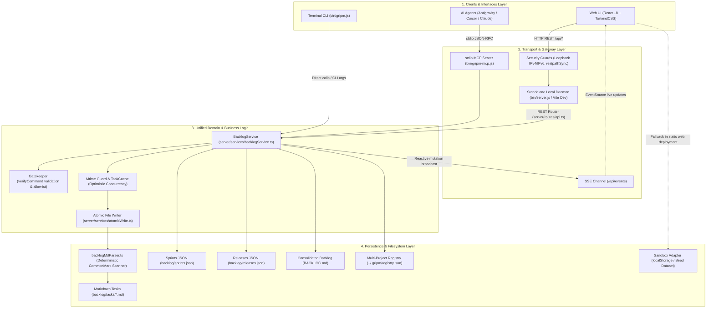
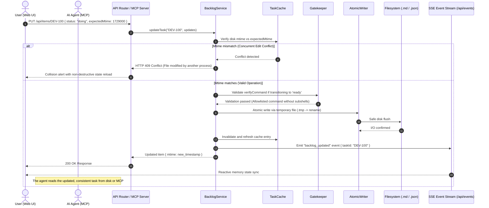
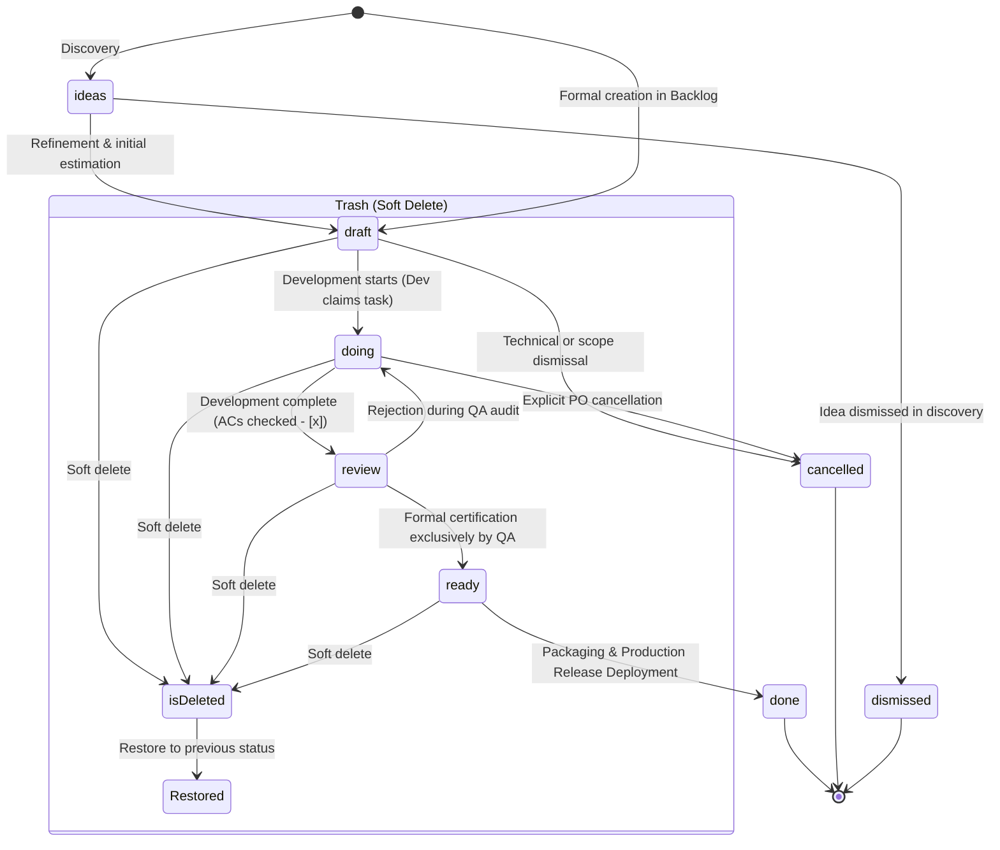
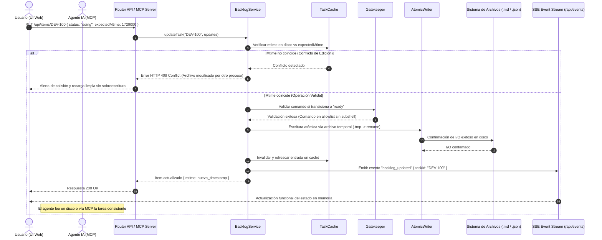
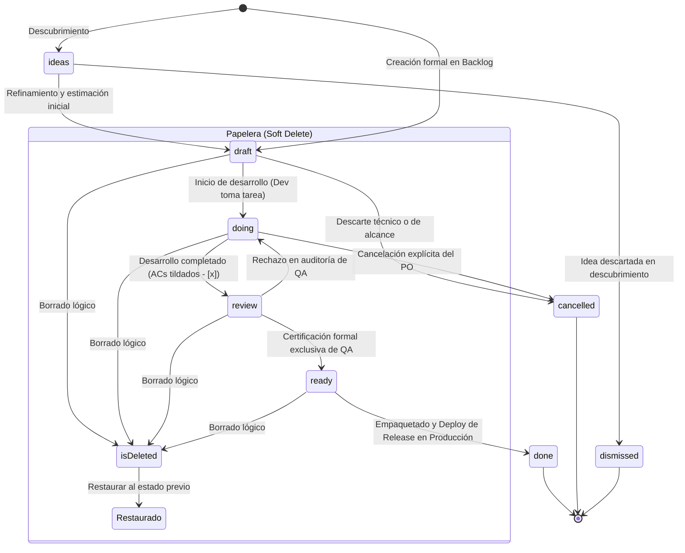

# Gripm System Architecture

🌐 **[English](#gripm-system-architecture)** | **[Español](#arquitectura-del-sistema-gripm)**

This document describes the topology, layers, data flow, concurrency model, and component map of **gripm**. It serves as the canonical technical reference for both human developers and autonomous AI agents (Antigravity, Cursor, Claude Code) to streamline codebase navigation, state machine comprehension, and impact analysis.

---

## 1. System Overview

gripm is an *embedded-first* agile product and engineering cockpit designed for seamless collaboration between human developers and AI agents:

- **Local-first & Zero-cloud**: All data resides in the local repository as native Markdown (`backlog/tasks/*.md`) with YAML frontmatter or local JSON databases.
- **Strict Dogfooding**: Every code change is associated with and synchronized to live backlog tasks under the Gripm Playbook methodology.
- **Triple Unified Interface**:
  1. **Visual Web UI**: Web application built with React 18, Vite, and Tailwind CSS.
  2. **Agent / MCP Protocol**: stdio server (`bin/gripm-mcp.js`) exposing semantic tools (`gripm_list_tasks`, `gripm_update_task`, etc.) for autonomous agents.
  3. **Terminal CLI**: Local and global executable binary (`bin/gripm.js`) for rapid, headless workflow execution and project onboarding (`gripm init`).
- **Dual Runtime**:
  - **Local Daemon Mode**: Embedded Node.js backend (`bin/server.js`) with native HTTP server and persistent disk I/O.
  - **Web Sandbox Mode (Vercel)**: In-memory and `localStorage` adapter (`src/data/sandbox.ts`) maintaining 100% API contract parity (`GripmApi`).

---

## 2. General Topology and Data Flow

---

## 3. Atomic Mutation Flow and Optimistic Concurrency

To prevent collisions when an AI agent and a human user interact concurrently in the web interface, the system implements an optimistic concurrency protocol based on file modification timestamps (`expectedMtime`) backed by atomic disk persistence and real-time SSE broadcast.

---

## 4. Agile Delivery Flow State Machine

The task lifecycle in gripm adheres to the formal state machine specified in the Playbook framework, enforcing strict separation between development, certification, and deployment:

> [!IMPORTANT]
> **State Flow Invariants:**
> 1. **The agent/developer finish line is `ready`**. A developer or agent never sets `done`.
> 2. **Transitioning to `done` is exclusive to Release Management**: No task moves to `done` without being packaged and deployed into a production release.
> 3. **Reversible soft-delete**: Any item sent to Trash retains its `previousStatus` to ensure a 100% clean restoration.

---

## 5. Key File Catalog and Modular Decomposition

### Modular Frontend (`src/`)

To preserve modularity, performance, and ergonomic responsiveness, components adhere to modular guidelines (< 500 lines of code) with heavy and specialized views code-split via React `lazy()`:

| File / Directory | Core Responsibility |
| :--- | :--- |
| [src/App.tsx](src/App.tsx) | Main UI orchestrator. Manages active project, view routing, keyboard shortcuts, and SSE subscriptions. |
| [src/components/Header.tsx](src/components/Header.tsx) | Top navigation bar with multi-project selector, view switcher, global search, and release update alerts. |
| [src/components/KanbanBoard.tsx](src/components/KanbanBoard.tsx) | Visual Kanban board with status columns, drag & drop, grouping, and 60 FPS optimized rendering. |
| [src/components/SprintView.tsx](src/components/SprintView.tsx) | Sprint planning view with velocity tracking, burndown metrics, and workload balancing. |
| [src/components/TimelineView.tsx](src/components/TimelineView.tsx) | Code-split roadmap timeline view visualizing milestones, dependencies, and delivery windows. |
| [src/components/MetricsView.tsx](src/components/MetricsView.tsx) | Code-split engineering analytics dashboard displaying throughput, cycle times, and quality metrics. |
| [src/components/ReleaseAssembler.tsx](src/components/ReleaseAssembler.tsx) | Code-split release builder (`unreleased` / `released`), changelog generator, and Git tag integration. |
| [src/components/TrashView.tsx](src/components/TrashView.tsx) | Code-split trash panel with soft-delete support, clean status restoration, and permanent purge. |
| [src/components/FilterBar.tsx](src/components/FilterBar.tsx) | Quick filter bar with interactive chips for text search, task types, priorities, and assignees. |
| [src/components/AdvancedFiltersPopover.tsx](src/components/AdvancedFiltersPopover.tsx) | Combined popover for advanced multi-select filtering across sprints, releases, and modules. |
| [src/utils/filterItems.ts](src/utils/filterItems.ts) | Unified typed filter engine for Kanban, Sprint, Backlog, and Timeline views. |
| [src/components/ItemModal.tsx](src/components/ItemModal.tsx) | Lazy-loaded task detail orchestrator delegating presentation to modular panels in `src/components/item-modal/`. |
| [src/components/item-modal/](src/components/item-modal/) | Modular task modal panels: `AcceptanceCriteriaPanel`, `ItemRelationsPanel`, `ItemDescriptionPanel`, `ItemSidebarAttributes`, `ItemSidebarSchedule`, etc. |
| [src/components/SettingsView.tsx](src/components/SettingsView.tsx) | Code-split settings view delegating tabs to modular panels in `src/components/settings/`. |
| [src/components/settings/](src/components/settings/) | Modular settings tabs: `KanbanTab`, `TaxonomyTab`, `ViewsTab`, `ModulesTab`, `ComponentsTab`, `ToolsTab`, `AdvancedTab`, `VisualTab`. |
| [src/components/ImportWizardModal.tsx](src/components/ImportWizardModal.tsx) | Universal import modal wizard supporting Jira, Linear, GitHub, and CSV datasets. |
| [src/data/sandbox.ts](src/data/sandbox.ts) | Interactive demonstration adapter for static web deployments (Vercel) with 100% `GripmApi` contract parity. |

### Embedded Backend, Services & CLI Tools (`server/`, `scripts/`, `bin/`)

| File / Directory | Core Responsibility |
| :--- | :--- |
| [server/services/backlogService.ts](server/services/backlogService.ts) | **Canonical and unified persistence and domain engine.** Centralizes disk reading, mutations, metrics, Gatekeeper validations, and atomic locks. |
| [server/services/taskCache.ts](server/services/taskCache.ts) | High-performance in-memory task cache with disk `mtime` verification for instantaneous reads and cache invalidation. |
| [server/services/atomicWrite.ts](server/services/atomicWrite.ts) | Crash-resilient file writer using temporary files and atomic rename operations (`.tmp -> rename`). |
| [server/routes/api.ts](server/routes/api.ts) | REST API router exposing local endpoints (`/api/data`, `/api/items`, `/api/projects`, `/api/events`, etc.). |
| [server/middleware/security.ts](server/middleware/security.ts) | Local isolation guardrails: strict loopback enforcement (`127.0.0.1` and `[::1]`) and header sanitization. |
| [server/services/fsExplorer.ts](server/services/fsExplorer.ts) | Secure folder explorer with strict path containment via `realpathSync` preventing symlink traversal. |
| [bin/server.js](bin/server.js) | Standalone packaged production HTTP server (pure Node.js without runtime Vite dependencies). |
| [bin/gripm.js](bin/gripm.js) | Unified CLI binary (`gripm`). Launches daemons, manages project registration, imports backlogs, and scaffolds suites. |
| [bin/gripm-mcp.js](bin/gripm-mcp.js) | Executable MCP server exposing the `gripm_*` tool catalog to AI agents via `stdio` JSON-RPC. |
| [scripts/backlogMdParser.ts](scripts/backlogMdParser.ts) | Bidirectional deterministic CommonMark tokenizer between Markdown files (`backlog/tasks/*.md`), `BACKLOG.md`, and memory. |
| [scripts/build-binaries.js](scripts/build-binaries.js) | Standalone executable build script using `esbuild` to compile production bundles into `bin/`. |
| [scripts/verify-backlog-sync.js](scripts/verify-backlog-sync.js) | Live pre-commit verification guard auditing task consistency, AC integrity, and regenerating `BACKLOG.md`. |

---

## 6. Security and Threat Model

The system implements defense-in-depth audited under security guidelines `SEC-01` through `SEC-10`:

1. **Loopback Isolation:** The local daemon binds by default exclusively to `127.0.0.1` and `::1`. Remote requests and unauthorized host headers are rejected.
2. **Secure Gatekeeper (SEC-01):** Command execution during transition to `ready` is only permitted if explicitly passed as an MCP argument, rejecting subshells (`$()`), pipes (`|`), redirections (`>`), or execution chains (`&&`, `;`). Executing commands from Markdown frontmatter is strictly prohibited.
3. **Filesystem Path Containment (SEC-07):** Folder resolution in the project explorer validates physical paths (`realpathSync`) against allowed boundaries to neutralize symlink traversal exploits.
4. **Zero Fabrication of ACs (SEC-02):** Automatic synchronization operates with `autoFix: false` by default, preventing tools from mutating unchecked checkboxes (`- [ ]`) into checked ones (`- [x]`) without real verification.

---

## 7. Blast Radius and Impact Table

| If you need to modify... | Primary files to touch | Side effects to monitor |
| :--- | :--- | :--- |
| **Persistence, mutations, or domain logic** | [server/services/backlogService.ts](server/services/backlogService.ts), [server/services/taskCache.ts](server/services/taskCache.ts) | Contract parity with MCP (`bin/gripm-mcp.js`), REST API, and Sandbox. |
| **Markdown format, YAML, or task sections** | [scripts/backlogMdParser.ts](scripts/backlogMdParser.ts) | Run `scripts/test-parser-roundtrip.js` (zero data loss). |
| **Task edit panels or item modal forms** | [src/components/item-modal/](src/components/item-modal/), [src/components/ItemModal.tsx](src/components/ItemModal.tsx) | Maintain accessible ARIA contracts and keyboard focus traps. |
| **Settings tabs or configuration panels** | [src/components/settings/](src/components/settings/), [src/components/SettingsView.tsx](src/components/SettingsView.tsx) | Synchronization with `.gripm/config.json` and localStorage. |
| **Filtering, search, or multi-select queries** | [src/utils/filterItems.ts](src/utils/filterItems.ts), [src/components/FilterBar.tsx](src/components/FilterBar.tsx) | Consistency across Kanban, Backlog, Sprint, and Timeline views. |
| **AI agent tools (MCP protocol)** | [scripts/mcp-server.ts](scripts/mcp-server.ts), [server/services/backlogService.ts](server/services/backlogService.ts) | Input schema validations and alignment with `AGENTS.md`. |
| **Local REST endpoints or SSE transport** | [server/routes/api.ts](server/routes/api.ts), [src/api.ts](src/api.ts) | Local CORS handling and resilient EventSource reconnects. |

---

## 8. Canonical Task Data Specification

Each task in gripm resides at `backlog/tasks/<ID> - <slug>.md`. It consists of structured YAML frontmatter metadata and Markdown body content bounded by canonical HTML section markers:

### A. YAML Frontmatter Metadata

| Frontmatter Field | TypeScript Type / Values | Semantics & Purpose |
| :--- | :--- | :--- |
| `id` | `string` (e.g. `DEV-110`) | Immutable, unique task identifier. |
| `title` | `string` | Task title describing the requirement or fix. |
| `status` | `CanonicalStatus` (`ideas`, `draft`, `doing`, `review`, `ready`, `done`, `dismissed`, `cancelled`) | Formal delivery state in the value stream. |
| `type` | `ItemType` (`feature`, `bug`, `tech_debt`, `ux`, `epic`, `initiative` + custom) | Functional taxonomy. Supports dynamic custom types. |
| `priority` | `Priority` (`p0`/`urgent`, `p1`/`high`, `p2`/`medium`, `p3`/`low`) | Urgency and severity classification. |
| `estimate` | `number` or `string` (e.g. `5` or `"XL"`) | Effort estimation points or t-shirt size. |
| `assignee` / `assignees` | `string[]` or `string` | Assigned individuals or agent IDs. |
| `labels` | `string[]` | Categorization tags for filtering. |
| `sprint` / `targetSprint` | `string` (e.g. `"Sprint 6"`) | Currently targeted execution sprint. |
| `sprints` | `string[]` | Complete sprint assignment history. |
| `release` / `targetRelease` | `string` (e.g. `"1.10.0"`) | Planned or delivered release version. |
| `releases` | `string[]` | Multi-release assignment array. |
| `modules` | `string[]` | Functional subsystem and architectural modules. |
| `parent` / `parentId` | `string` (e.g. `"DEV-040"`) | 1-to-N parent item (Epic or Initiative). |
| `blocks` | `string[]` | Tasks dependent on the delivery of this item. |
| `blocked_by` / `blockedBy` | `string[]` | Tasks that must finish before this item can begin. |
| `related_to` / `relatedTo` | `string[]` | Non-blocking conceptual associations. |
| `dependencies` | `string[]` | Functional dependency list. |
| `created_date` | `string` (datetime/ISO) | Original creation timestamp. |
| `updated_date` | `string` (datetime/ISO) | Last modification timestamp on disk. |
| `order` | `number` | Relative ordering position within view columns. |
| `isDeleted` | `boolean` | Soft-delete flag (Trash). |
| `deletedAt` | `string` (ISO) | Timestamp when moved to trash. |
| `previousStatus` | `string` | Previous status preserved for clean restoration. |
| *Arbitrary* (`rawExtraFrontmatter`) | `Record<string, string>` | Unrecognized YAML keys preserved during round-trip. |

### B. Delimited Markdown Body Sections

| Section | Canonical Delimiter | Purpose |
| :--- | :--- | :--- |
| `## Description` | `<!-- SECTION:DESCRIPTION:BEGIN -->` ... `<!-- SECTION:DESCRIPTION:END -->` | Background, user stories, and specifications. |
| `## Acceptance Criteria` | `<!-- AC:BEGIN -->` ... `<!-- AC:END -->` | Acceptance criteria (`- [x] #1`, `- [ ] #1`) and BDD scenarios. |
| `## Implementation Plan` | `<!-- SECTION:PLAN:BEGIN -->` ... `<!-- SECTION:PLAN:END -->` | Phased development plan (Plan Guard). |
| `## Implementation Notes` | `<!-- SECTION:NOTES:BEGIN -->` ... `<!-- SECTION:NOTES:END -->` | Technical notes, implemented changes, and residual risks. |
| `## Final Summary` | `<!-- SECTION:FINAL_SUMMARY:BEGIN -->` ... `<!-- SECTION:FINAL_SUMMARY:END -->` | Handoff and completion summary. |

---

## 9. Architecture Decision Records (ADR)

This document describes **how the system is built today**. The historical rationale and evaluated alternatives are documented in [`docs/adr/`](adr/README.md).

| # | Decision |
| :--- | :--- |
| [0001](adr/0001-markdown-como-fuente-de-verdad.md) | Markdown as single source of truth for the backlog |
| [0002](adr/0002-backend-embebido-como-plugin-de-vite.md) | Embedded backend as Vite middleware plugin (Superseded) |
| [0003](adr/0003-servidor-mcp-por-stdio.md) | stdio MCP server sharing unified persistence core |
| [0004](adr/0004-daemon-local-sin-autenticacion-http.md) | Single-user local daemon without HTTP authentication |
| [0005](adr/0005-overlays-via-portales-y-layout-estable.md) | Portal-mounted overlays and stable root layout (zero CLS) |
| [0006](adr/0006-servidor-estatico-produccion-desacoplado-de-vite.md) | Static HTTP server decoupled from Vite for production |

Every decision with structural impact is recorded as an immutable, sequentially numbered ADR in [`docs/adr/`](adr/).

---

# Arquitectura del Sistema gripm

🌐 **[English](#gripm-system-architecture)** | **[Español](#arquitectura-del-sistema-gripm)**

Este documento describe la topología, capas, flujo de datos, concurrencia y mapa de componentes de **gripm**. Constituye la referencia técnica canónica tanto para desarrolladores humanos como para agentes autónomos de IA (Antigravity, Cursor, Claude Code) con el fin de agilizar la navegación del código, el entendimiento del flujo de estados y el análisis de impacto.

---

## 1. Visión General del Sistema

gripm es un tablero ágil de gestión de producto e ingeniería *embedded-first* diseñado para la colaboración fluida entre desarrolladores humanos y agentes de IA:

- **Local-first & Zero-cloud**: Todos los datos residen en el repositorio local en formato Markdown nativo (`backlog/tasks/*.md`) con frontmatter YAML o en base JSON local.
- **Dogfooding estricto**: Cada cambio de código se asocia y sincroniza con tareas vivas del backlog bajo la metodología de Gripm Playbook.
- **Triple Interfaz Unificada**:
  1. **UI Web Visual**: Aplicación web desarrollada en React 18 + Vite + Tailwind CSS.
  2. **Agente / Protocolo MCP**: Servidor stdio (`bin/gripm-mcp.js`) que expone herramientas semánticas (`gripm_list_tasks`, `gripm_update_task`, etc.) para agentes autónomos.
  3. **CLI de Terminal**: Binario ejecutable local y global (`bin/gripm.js`) para gestión rápida, headless y onboarding de suite (`gripm init`).
- **Dual Runtime**:
  - **Modo Daemon Local**: Backend Node.js embebido (`bin/server.js`) con servidor HTTP nativo y persistencia real en disco.
  - **Modo Sandbox Web (Vercel)**: Adaptador en memoria y `localStorage` (`src/data/sandbox.ts`) con paridad 100% de contrato de API (`GripmApi`).

---

## 2. Topología General y Flujo de Datos

---

## 3. Flujo de Mutación Atómica y Concurrencia Optimista

Para evitar colisiones cuando un agente de IA y un usuario interactúan simultáneamente en la interfaz web, el sistema implementa un protocolo de concurrencia optimista basado en `expectedMtime` con persistencia atómica en disco y difusión en tiempo real vía SSE.

---

## 4. Máquina de Estados del Flujo Ágil

El ciclo de vida de los ítems en gripm sigue la máquina de estados formal normada en el framework Playbook, con estricta separación entre desarrollo, certificación y despliegue:

> [!IMPORTANT]
> **Invariantes del Flujo de Estados:**
> 1. **La línea de llegada del agente/desarrollador es `ready`**. Un desarrollador o agente jamás marca `done`.
> 2. **El paso a `done` es exclusivo de Release Management**: Ninguna tarea pasa a `done` sin estar empaquetada y desplegada formalmente en una versión.
> 3. **Soft-delete reversible**: Cualquier ítem enviado a la Papelera conserva su `previousStatus` para garantizar una restauración 100% limpia.

---

## 5. Catálogo de Archivos Clave y Descomposición Modular

### Frontend Modular (`src/`)

Para garantizar modularidad y mantenibilidad, los componentes monolíticos históricos fueron descompuestos en submódulos especializados (< 500 líneas) y vistas pesadas cargadas dinámicamente con `React.lazy()`:

| Archivo / Directorio | Responsabilidad Principal |
| :--- | :--- |
| [src/App.tsx](src/App.tsx) | Orquestador principal de la UI. Mantiene estado de proyecto, vistas activas, routing, atajos de teclado y suscripción a eventos SSE. |
| [src/components/Header.tsx](src/components/Header.tsx) | Barra superior con selector de proyecto multi-repo, switcher de vistas, búsqueda global y notificaciones de versión. |
| [src/components/KanbanBoard.tsx](src/components/KanbanBoard.tsx) | Tablero visual Kanban con columnas por estado, drag & drop, agrupación y renderizado optimizado a 60 FPS. |
| [src/components/SprintView.tsx](src/components/SprintView.tsx) | Vista de planificación de sprints, velocidad, burndown y balance de carga. |
| [src/components/TimelineView.tsx](src/components/TimelineView.tsx) | Vista code-split de Roadmap y línea de tiempo visualizando hitos, dependencias y ventanas de entrega. |
| [src/components/MetricsView.tsx](src/components/MetricsView.tsx) | Dashboard code-split de analíticas de ingeniería, throughput, tiempos de ciclo y métricas de calidad. |
| [src/components/ReleaseAssembler.tsx](src/components/ReleaseAssembler.tsx) | Ensamblador code-split de versiones (`unreleased` / `released`), generador de changelogs y vinculación de tags Git. |
| [src/components/TrashView.tsx](src/components/TrashView.tsx) | Panel code-split de Papelera con soporte para soft-delete, restauración segura al estado previo y purga definitiva. |
| [src/components/FilterBar.tsx](src/components/FilterBar.tsx) | Barra de filtrado rápido con chips interactivos para búsqueda, tipos, prioridades y asignados. |
| [src/components/AdvancedFiltersPopover.tsx](src/components/AdvancedFiltersPopover.tsx) | Popover con filtros avanzados combinados y multi-selección de sprints, releases y módulos. |
| [src/utils/filterItems.ts](src/utils/filterItems.ts) | Motor de filtrado unificado y tipado para Kanban, Sprint, Backlog y Timeline con soporte para campos multi-valor. |
| [src/components/ItemModal.tsx](src/components/ItemModal.tsx) | Orquestador de detalle de tarea code-split. Delega su renderizado en submódulos de `src/components/item-modal/`. |
| [src/components/item-modal/](src/components/item-modal/) | Submódulos del modal de tareas: `AcceptanceCriteriaPanel`, `ItemRelationsPanel`, `ItemDescriptionPanel`, `ItemSidebarAttributes`, `ItemSidebarSchedule`, `ItemSidebarStatusType`, etc. |
| [src/components/SettingsView.tsx](src/components/SettingsView.tsx) | Orquestador code-split de configuración general. Delega su renderizado en las pestañas de `src/components/settings/`. |
| [src/components/settings/](src/components/settings/) | Pestañas modulares: `KanbanTab`, `TaxonomyTab`, `ViewsTab`, `ModulesTab`, `ComponentsTab`, `ToolsTab`, `AdvancedTab`, `VisualTab`. |
| [src/components/ImportWizardModal.tsx](src/components/ImportWizardModal.tsx) | Modal asistente de importación universal con soporte para Jira, Linear, GitHub y archivos CSV. |
| [src/data/sandbox.ts](src/data/sandbox.ts) | Adaptador interactivo de demostración para despliegues estáticos web (Vercel) con paridad total del contrato `GripmApi`. |

### Backend Embebido, Servicios & Herramientas (`server/`, `scripts/`, `bin/`)

| Archivo / Directorio | Responsabilidad Principal |
| :--- | :--- |
| [server/services/backlogService.ts](server/services/backlogService.ts) | **Motor canónico y único de persistencia y dominio.** Centraliza la lectura, mutación, cálculo de métricas, validaciones de Gatekeeper y bloqueo atómico. |
| [server/services/taskCache.ts](server/services/taskCache.ts) | Memoria caché de alto rendimiento con validación de `mtime` en disco para lecturas instantáneas e invalidación reactiva. |
| [server/services/atomicWrite.ts](server/services/atomicWrite.ts) | Escritor de archivos resiliente a caídas basado en escritura temporal y renombramiento atómico (`.tmp -> rename`). |
| [server/routes/api.ts](server/routes/api.ts) | Router REST de endpoints locales (`/api/data`, `/api/items`, `/api/projects`, `/api/events`, etc.). |
| [server/middleware/security.ts](server/middleware/security.ts) | Guardrails de aislamiento local: validación de loopback estricto (`127.0.0.1` y `[::1]`) y sanitización de encabezados. |
| [server/services/fsExplorer.ts](server/services/fsExplorer.ts) | Explorador de carpetas seguro con contención estricta mediante `realpathSync` contra ataques de symlink traversal. |
| [bin/server.js](bin/server.js) | Servidor standalone empaquetado para producción (Node.js nativo sin dependencias de Vite en runtime). |
| [bin/gripm.js](bin/gripm.js) | CLI binario unificado (`gripm`). Inicializa daemon, ejecuta comandos headless y gestiona scaffolding con presets de suite. |
| [bin/gripm-mcp.js](bin/gripm-mcp.js) | Servidor MCP ejecutable que expone el catálogo `gripm_*` a agentes de IA mediante `stdio` JSON-RPC. |
| [scripts/backlogMdParser.ts](scripts/backlogMdParser.ts) | Tokenizador determinista CommonMark bidireccional entre archivos Markdown (`backlog/tasks/*.md`), `BACKLOG.md` y memoria. |
| [scripts/build-binaries.js](scripts/build-binaries.js) | Script de empaquetado con `esbuild` que compila los ejecutables standalone en `bin/`. |
| [scripts/verify-backlog-sync.js](scripts/verify-backlog-sync.js) | Guard de verificación viva pre-commit que audita coherencia de tareas, ACs y regenera `BACKLOG.md`. |

---

## 6. Seguridad y Superficie de Riesgo

El sistema implementa defensas en profundidad auditadas bajo los lineamientos `SEC-01` a `SEC-10`:

1. **Aislamiento en Loopback:** El daemon local se vincula por defecto exclusivamente a `127.0.0.1` y `::1`. Las peticiones externas o con host headers no autorizados son rechazadas.
2. **Gatekeeper Seguro (SEC-01):** La ejecución de comandos en el paso a `ready` solo se permite si el comando fue provisto explícitamente como argumento del MCP, rechazando subshells (`$()`), pipes (`|`), redirecciones (`>`) o cadenas de ejecución (`&&`, `;`). Queda terminantemente prohibido ejecutar comandos desde el frontmatter Markdown.
3. **Contención de Rutas de Filesystem (SEC-07):** Toda resolución de directorios en el navegador de proyectos valida la ruta física real (`realpathSync`) contra la raíz permitida para neutralizar enlaces simbólicos maliciosos.
4. **Cero Fabricación de ACs (SEC-02):** La sincronización automática opera con `autoFix: false` por defecto para impedir que herramientas alteren checkboxes `- [ ]` a `- [x]` sin verificación real.

---

## 7. Tabla de Impacto Rápido

| Si necesitas modificar... | Archivos principales a intervenir | Efecto colateral a vigilar |
| :--- | :--- | :--- |
| **Persistencia, mutaciones o reglas de negocio** | [server/services/backlogService.ts](server/services/backlogService.ts), [server/services/taskCache.ts](server/services/taskCache.ts) | Paridad con MCP (`bin/gripm-mcp.js`), API REST y sandbox. |
| **Formato Markdown, YAML o secciones de tarea** | [scripts/backlogMdParser.ts](scripts/backlogMdParser.ts) | Correr `scripts/test-parser-roundtrip.js` (cero pérdida de datos). |
| **Formulario o paneles de edición de tareas** | [src/components/item-modal/](src/components/item-modal/), [src/components/ItemModal.tsx](src/components/ItemModal.tsx) | Preservar trampa de foco y contratos ARIA accesibles. |
| **Pestañas o paneles de configuración** | [src/components/settings/](src/components/settings/), [src/components/SettingsView.tsx](src/components/SettingsView.tsx) | Sincronización con `.gripm/config.json` y localStorage. |
| **Filtrado, búsqueda o multi-selección** | [src/utils/filterItems.ts](src/utils/filterItems.ts), [src/components/FilterBar.tsx](src/components/FilterBar.tsx) | Consistencia en Kanban, Backlog, Sprint y Timeline. |
| **Herramientas para agentes IA (MCP)** | [scripts/mcp-server.ts](scripts/mcp-server.ts), [server/services/backlogService.ts](server/services/backlogService.ts) | Validar schemas de entrada y compatibilidad con `AGENTS.md`. |
| **Endpoints locales o transporte SSE** | [server/routes/api.ts](server/routes/api.ts), [src/api.ts](src/api.ts) | Manejo de CORS local y reconexión resiliente de eventos. |

---

## 8. Modelo Canónico de Datos de Tareas (Task Data Specification)

Cada tarea en gripm reside en `backlog/tasks/<ID> - <slug>.md`. Se compone de metadatos estructurados en YAML frontmatter y secciones de contenido delimitadas por comentarios HTML canónicos:

### A. Metadatos de YAML Frontmatter

| Campo Frontmatter | Tipo TypeScript / Valores | Semántica y Propósito |
| :--- | :--- | :--- |
| `id` | `string` (ej. `DEV-110`) | Identificador unívoco e inmutable. |
| `title` | `string` | Título del requerimiento o corrección. |
| `status` | `CanonicalStatus` (`ideas`, `draft`, `doing`, `review`, `ready`, `done`, `dismissed`, `cancelled`) | Estado formal en el flujo de valor. |
| `type` | `ItemType` (`feature`, `bug`, `tech_debt`, `ux`, `epic`, `initiative` + personalizados) | Taxonomía funcional. Admite tipos dinámicos. |
| `priority` | `Priority` (`p0`/`urgent`, `p1`/`high`, `p2`/`medium`, `p3`/`low`) | Nivel de urgencia o severidad. |
| `estimate` | `number` o `string` (ej. `5` o `"XL"`) | Estimación de esfuerzo. |
| `assignee` / `assignees` | `string[]` o `string` | Responsables asignados. |
| `labels` | `string[]` | Etiquetas transversales de búsqueda. |
| `sprint` / `targetSprint` | `string` (ej. `"Sprint 6"`) | Sprint de ejecución actual. |
| `sprints` | `string[]` | Historial de sprints asociados. |
| `release` / `targetRelease` | `string` (ej. `"1.10.0"`) | Versión de entrega planificada o entregada. |
| `releases` | `string[]` | Array multi-versión asignado. |
| `modules` | `string[]` | Módulos funcionales asociados a la tarea. |
| `parent` / `parentId` | `string` (ej. `"DEV-040"`) | Padre jerárquico 1-a-N (Épica o iniciativa). |
| `blocks` | `string[]` | Tareas que dependen de la entrega de este ítem. |
| `blocked_by` / `blockedBy` | `string[]` | Tareas que bloquean el inicio de este ítem. |
| `related_to` / `relatedTo` | `string[]` | Enlaces conceptuales no bloqueantes. |
| `dependencies` | `string[]` | Lista de dependencias funcionales del ítem. |
| `created_date` | `string` (datetime/ISO) | Fecha original de creación. |
| `updated_date` | `string` (datetime/ISO) | Timestamp de última modificación en disco. |
| `order` | `number` | Posición relativa en columnas de visualización. |
| `isDeleted` | `boolean` | Flag de borrado lógico (Papelera). |
| `deletedAt` | `string` (ISO) | Fecha y hora de envío a la papelera. |
| `previousStatus` | `string` | Estado previo para restauración limpia. |
| *Arbitrarios* (`rawExtraFrontmatter`) | `Record<string, string>` | Claves YAML adicionales preservadas en round-trip. |

### B. Secciones Delimitadas en el Cuerpo Markdown

| Sección | Delimitador Canónico | Propósito |
| :--- | :--- | :--- |
| `## Description` | `<!-- SECTION:DESCRIPTION:BEGIN -->` ... `<!-- SECTION:DESCRIPTION:END -->` | Contexto, especificación y User Stories. |
| `## Acceptance Criteria` | `<!-- AC:BEGIN -->` ... `<!-- AC:END -->` | Criterios de aceptación (`- [x] #1`, `- [ ] #1`) y escenarios BDD. |
| `## Implementation Plan` | `<!-- SECTION:PLAN:BEGIN -->` ... `<!-- SECTION:PLAN:END -->` | Plan de desarrollo paso a paso (Plan Guard). |
| `## Implementation Notes` | `<!-- SECTION:NOTES:BEGIN -->` ... `<!-- SECTION:NOTES:END -->` | Notas técnicas de desarrollo, cambios aplicados y riesgos. |
| `## Final Summary` | `<!-- SECTION:FINAL_SUMMARY:BEGIN -->` ... `<!-- SECTION:FINAL_SUMMARY:END -->` | Resumen de cierre o entrega de la tarea. |

---

## 9. Registro de Decisiones de Arquitectura (ADR)

Este documento describe **cómo está construido el sistema actualmente**. Los fundamentos de las decisiones y las alternativas evaluadas se documentan en [`docs/adr/`](adr/README.md).

| # | Decisión |
| :--- | :--- |
| [0001](adr/0001-markdown-como-fuente-de-verdad.md) | Markdown como fuente de verdad del backlog |
| [0002](adr/0002-backend-embebido-como-plugin-de-vite.md) | Backend embebido como plugin de middleware de Vite (Reemplazado) |
| [0003](adr/0003-servidor-mcp-por-stdio.md) | Servidor MCP sobre stdio con núcleo de persistencia compartido |
| [0004](adr/0004-daemon-local-sin-autenticacion-http.md) | Daemon local monousuario sin autenticación HTTP |
| [0005](adr/0005-overlays-via-portales-y-layout-estable.md) | Overlays montados vía portales y layout raíz estable (cero CLS) |
| [0006](adr/0006-servidor-estatico-produccion-desacoplado-de-vite.md) | Servidor estático HTTP desacoplado de Vite para producción |

Toda decisión con impacto estructural se documenta como un ADR numerado secuencial e inmutable en [`docs/adr/`](adr/).
