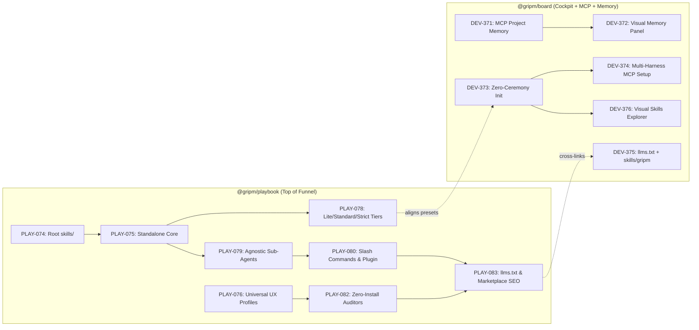

# Gripm Ecosystem - Next-Level Vision & Market Repositioning Roadmap

> **North Star:** Make Gripm (`@gripm/board` + `@gripm/playbook`) the #1 local-first, zero-friction **Engineering Cockpit, Persistent Memory, and Deterministic Agent Governance Suite** for any developer, any repository, and any AI coding agent (`skills.sh`, Claude Code, Cursor, Windsurf, Copilot, OpenCode, Antigravity).

---

## 1. Strategic Context: Why Reposition Now

Gripm Board (`@gripm/board`) already delivers strong immediate value: a local-first web cockpit (`localhost:4100`), distributed Markdown or single-JSON storage, and a native `stdio` MCP server (`gripm-mcp`). However, market analysis against `skills.sh`, `LinklyAI/best-skills`, `mcpmarket.com`, `awesomeskill.ai`, `phuryn/pm-skills`, and `gentle-ai` (`Gentleman-Programming`) highlights a clear growth asymmetry:

- **Top-of-Funnel Friction:** Adopting Gripm Playbook today feels like installing strict internal process rules before experiencing the superpower. Developers on `skills.sh` prefer atomic, zero-ceremony tools (`npx skills add`) and persistent memory (`Engram`) that solve acute problems immediately.
- **Missing Persistent Memory:** Agents forget architectural decisions and bug root causes across sessions and context compactions. `gripm-mcp` already runs inside the user's project and can solve this natively without external databases or compiled Go binaries.
- **Manual Harness Setup:** Wiring `gripm-mcp`, slash commands, and skills across Claude Code, Cursor, VS Code Copilot, Windsurf, and OpenCode currently requires manual JSON copy-pasting.

---

## 2. How `@gripm/board` & `@gripm/playbook` Form a Unified Growth Engine

1. **Zero-Friction Top of Funnel (`@gripm/playbook` on `skills.sh` & Plugin Marketplaces):**
   Developers discover and install standalone skills (`npx skills add pablojavierrodriguez/gripm-playbook`) or slash commands (`/audit-ux`, `/audit-health`, `/qa-blind`, `/discover`) powered by **zero-token deterministic AST auditors** - requiring zero `backlog/tasks/` ceremony (`lite` mode).
2. **Natural Upgrade to Visual Cockpit & Memory (`@gripm/board`):**
   When developers want persistent cross-session decision memory (`gripm_remember` / `gripm_recall`), visual Kanban/Sprint/Release management, and multi-harness MCP auto-setup, they add `@gripm/board` (`npx @gripm/board --init`) and unlock `standard` or `strict` governance at their own pace.

---

## 3. `@gripm/board` Epics & Tasks (`DEV-371` to `DEV-376`)

### Epic 1 - Cross-Session Project Memory (`epic-1-agent-memory`)
Give every AI coding agent and developer persistent, token-efficient project memory directly inside `gripm-mcp` and visible in the web cockpit.

| ID | Title | Priority | Dependencies |
| :--- | :--- | :--- | :--- |
| `DEV-371` | Persistent decision & invariant memory engine in `gripm-mcp` (`gripm_remember` / `gripm_recall`) | `high` | - |
| `DEV-372` | Visual Project Memory & Decisions panel in the Web Cockpit | `medium` | `DEV-371` |

### Epic 2 - Frictionless Multi-Harness Onboarding (`epic-2-frictionless-onboarding`)
Eliminate setup friction and support all major AI coding assistants in one non-destructive step.

| ID | Title | Priority | Dependencies |
| :--- | :--- | :--- | :--- |
| `DEV-373` | Zero-Ceremony mode in `gripm --init` aligned with Playbook progressive tiers (`lite` / `standard` / `strict`) | `high` | - |
| `DEV-374` | Multi-harness auto-configuration of `gripm-mcp` and skills (`.mcp.json`, `.cursor/mcp.json`, `.vscode/mcp.json`, OpenCode) | `high` | `DEV-373` |

### Epic 3 - Marketplace Discovery & Visual Ecosystem Control (`epic-3-marketplace-reach`)
Expose Gripm to agent indexes (`skills.sh`, `LinklyAI`, `mcpmarket.com`) and surface installed skills/stacks directly in the web cockpit.

| ID | Title | Priority | Dependencies |
| :--- | :--- | :--- | :--- |
| `DEV-375` | Publish `llms.txt` (repo + `gripm.vercel.app`) and package `skills/gripm/SKILL.md` for `skills.sh` | `high` | - |
| `DEV-376` | Visual Agent Skills, Harnesses, and Stack Packs explorer in Gripm Settings | `medium` | `DEV-373` |

---

## 4. Companion `@gripm/playbook` Roadmap (`PLAY-074` to `PLAY-083`)

Tracked in the `gripm-playbook` repository (`docs/ROADMAP.md` & `backlog/tasks/PLAY-074..083`):

| Epic | Tasks | Goal |
| :--- | :--- | :--- |
| **Epic 1 - Open Atomic Skills** | `PLAY-074`, `PLAY-075` | Root `skills/` layout for `npx skills add` + Standalone Mode (zero `backlog/tasks/` coupling). |
| **Epic 2 - Universal Core & Stacks** | `PLAY-076`, `PLAY-077` | Purge personal dogfooding bias, split `audit-ux` into profiles, add `nextjs`, `typescript-strict`, `node-api`, `testing`, `python-api`. |
| **Epic 3 - Progressive Governance** | `PLAY-078` | Introduce `lite` (default), `standard`, and `strict` tiers in `init` and `AGENTS.md`. |
| **Epic 4 - Multi-Harness & Slash Commands** | `PLAY-079`, `PLAY-080`, `PLAY-081` | Harness-agnostic sub-agents (`.claude/agents/`, Copilot, Windsurf, OpenCode), 6 `/slash` commands, Claude Plugin manifest, and Lean PM/Discovery templates. |
| **Epic 5 - Portable Auditors & Market Reach** | `PLAY-082`, `PLAY-083` | Zero-install `npx -y @gripm/playbook` CLI routing, `llms.txt`, and `skills.sh` / `LinklyAI` SEO. |

---

## 5. Cross-Repo Execution Flow

